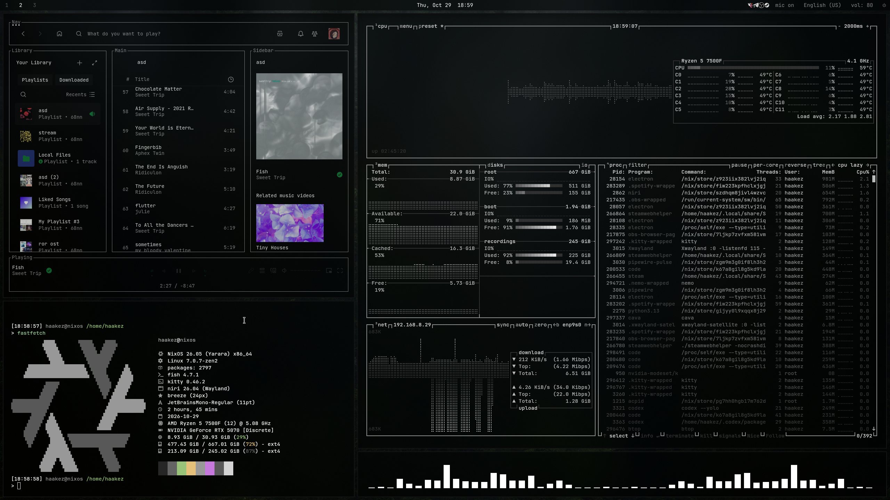
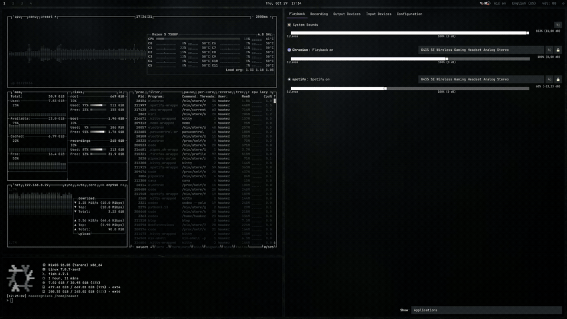

# haakez's nixos config


my nixos config built with home-manager, which uses niri as its compositor





## system components

- **OS:** NixOS
- **compositor:** Niri
- **shell:** Fish
- **terminal:** Kitty
- **bar:** Waybar
- **browser:** Firefox
- **file manager:** Nemo
- **launcher:** Fuzzel
- **notifications:** Fnott
- **system monitor:** btop

## structure

```text
nixos-configuration/
├── flake.nix
├── flake.lock
├── home.nix
├── hosts/
│   └── nixos/
│       ├── configuration.nix
│       └── hardware-configuration.nix
├── dotfiles/
│   ├── btop/
│   ├── fastfetch/
│   ├── fnott/
│   ├── fuzzel/
│   ├── gtk-theme/
│   │   ├── gtk-3.0/
│   │   └── gtk-4.0/
│   ├── kitty/
│   ├── niri/
│   ├── qt5ct/
│   ├── qt6ct/
│   └── waybar/
└── Wallpapers/
```

### nix files

- **`flake.nix`** defines the flake inputs and my hosts
- **`flake.lock`** locks the versions of the flake inputs
- **`home.nix`** defines the packages i use, also has some scripts and firefox/spicetifytui styling
- **`hosts/nixos/configuration.nix`** the unique thing here is that it has a custom scroll wheel and mouse accel, other than that it just has the drivers and some important pkgs
- **`hosts/nixos/hardware-configuration.nix`** you should delete this if ur installing this on a different machine

### dotfiles

almost all directories in `dotfiles/` are linked into `~/.config/` through home-manager

- **`niri/`** - window layout, rules, binds
- **`waybar/`** - the waybar config
- **`kitty/`** - terminal font, colors, and opacity
- **`fuzzel/`** - application launcher
- **`fnott/`** - notifications
- **`btop/`** - system monitor
- **`fastfetch/`** - terminal system information
- **`gtk-theme/`** - custom GTK3 and GTK4 theme
- **`qt5ct/`** and **`qt6ct/`** - qt6 and qt5 configs(i dont know why they still exist, they are useless and im too lazy to delete them)

### other

the **`Wallpapers/`** folder contains my... wallpapers, theyre pretty decent
  
if you want to actually install them, then:
```bash
git clone https://github.com/haaakez/nixos-configuration
cd nixos-configuration  # you might probably also want to replace the hardware config with the pre-generated config
```

Apply the configuration:

```bash
sudo nixos-rebuild switch --flake .#nixos
```